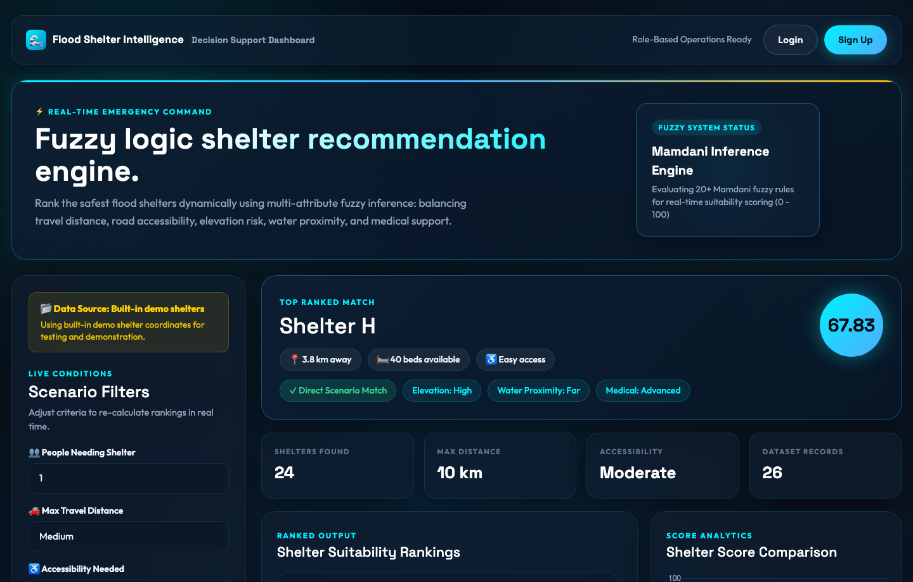
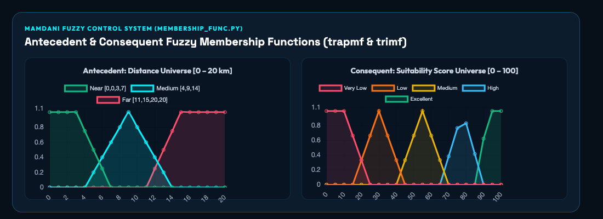
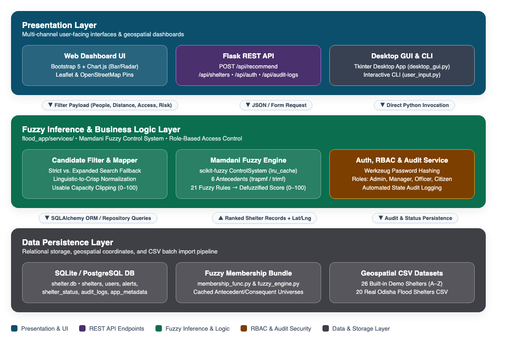
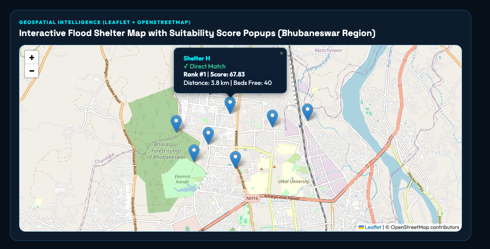

# Flood Shelter Recommendation System using Fuzzy Logic

[](https://www.python.org/)
[](https://flask.palletsprojects.com/)
[](https://github.com/scikit-fuzzy/scikit-fuzzy)
[](https://www.sqlalchemy.org/)

An intelligent **Multi-Criteria Decision Support System** for emergency flood evacuation powered by a **Mamdani Fuzzy Inference System (FIS)**. Instead of relying solely on shortest-path distance—where the nearest shelter may be low-lying, cut off by flooded roads, overcrowded, or adjacent to overflowing rivers—this system evaluates six operational and environmental factors simultaneously to rank shelters on a continuous **Suitability Score (0–100)**.

> **Live Demo:** [flood-shelter.vercel.app](https://flood-shelter.vercel.app/)  
> **Project Report:** [Flood_Shelter_Recommendation_System_Report.pdf](docs/Flood_Shelter_Recommendation_System_Report.pdf)

---

## Visual Overview

| Web Dashboard & Interactive Map | Mamdani Fuzzy Inference Surface |
| :---: | :---: |
|  |  |

| System Architecture | Geospatial Shelter Map (Leaflet) |
| :---: | :---: |
|  |  |

---

## How the Mamdani Fuzzy Inference Engine Works

Implemented in [`membership_func.py`](membership_func.py) using `scikit-fuzzy` and `numpy`, the engine evaluates **6 antecedents** using trapezoidal (`trapmf`) and triangular (`trimf`) membership functions across **21 domain-specific fuzzy rules**, producing a **Suitability Score (0–100)** via **centroid defuzzification**:

| Input / Output | Universe | Linguistic Terms |
| :--- | :---: | :--- |
| **Distance** (`distance`) | `0 – 20 km` | `near`, `medium`, `far` |
| **Available Capacity** (`capacity`) | `0 – 100 beds` | `low`, `medium`, `high` |
| **Road Accessibility** (`accessibility`) | `0 – 10` | `low`, `medium`, `high` |
| **Terrain Elevation** (`elevation`) | `0 – 10` | `low`, `medium`, `high` |
| **Water Proximity** (`proximity`) | `0 – 10` | `very_close`, `moderate`, `far` |
| **Medical Readiness** (`medical`) | `0 – 10` | `none`, `basic`, `advanced` |
| **Suitability Score** *(Output)* | `0 – 100` | `very_low`, `low`, `medium`, `high`, `excellent` |

---

## Key Features

- **Three Client Interfaces Sharing One Core:**
  - **Flask Web App (`app.py`):** Interactive dashboard with Bootstrap 5, Chart.js (bar + radar charts), and Leaflet/OpenStreetMap pins with score popups.
  - **Tkinter Desktop GUI (`desktop_gui.py`):** Standalone desktop application for offline/local dispatchers.
  - **CLI Mode (`user_input.py`):** Quick terminal-based recommendation tool.
- **Role-Based Authentication & Shelter Management:**
  - Session-based authentication with Werkzeug password hashing and roles (`admin`, `shelter_manager`, `citizen`, `response_officer`).
  - Shelter CRUD workflows, live bed/status updates, and persistent audit logs (`/manage/shelters`, `/manage/audit-logs`).
- **Real-World Odisha Dataset Support (`import_shelters.py`):**
  - Supports importing custom or real-world shelter CSVs (e.g., `real_flood_shelters.csv` with 20 Odisha flood shelters) alongside 26 built-in benchmark shelters in SQLite (`shelter.db`) or PostgreSQL.
- **RESTful JSON API:**
  - `POST /api/recommend` — Compute ranked fuzzy shelter recommendations
  - `GET / POST /api/shelters` & `GET / PUT / PATCH /api/shelters/<id>` — Shelter directory CRUD
  - `POST /api/shelters/<id>/status` — Operational status updates
  - `GET /api/audit-logs` — Action audit trail
  - `/api/auth/signup`, `/api/auth/login`, `/api/auth/me`, `/api/auth/logout`

---

## Project Structure

```text
├── app.py                     # Flask application entry point
├── membership_func.py         # Mamdani FIS (6 antecedents, 21 rules, centroid defuzzification)
├── recommender.py             # Compatibility wrapper for CLI & desktop interfaces
├── database.py                # SQLite schema creation and benchmark shelter seeding
├── import_shelters.py         # CSV importer for real-world shelter datasets
├── real_flood_shelters.csv    # 20 real-world Odisha flood shelter records
├── desktop_gui.py             # Tkinter desktop GUI
├── user_input.py              # Interactive CLI entry point
├── flood_app/
│   ├── config.py              # Environment-based app configuration
│   ├── models/                # SQLAlchemy ORM models (users, shelters, status, logs, alerts)
│   ├── repositories/          # Database access layer
│   ├── routes/                # Web & REST API blueprints
│   ├── schemas/               # Input validation & shared choices
│   └── services/              # Recommendation service & auth guards
├── templates/                 # Server-rendered HTML templates
├── static/                    # CSS & JS (Chart.js + Leaflet map logic)
├── migrations/                # Flask-Migrate / Alembic migrations
├── tests/                     # Pytest test suite
├── docs/                      # Major Project Report PDF & architecture figures
├── requirements.txt           # Python dependencies
└── vercel.json                # Vercel deployment configuration
```

---

## Quickstart & Local Setup

### 1. Clone & Install Dependencies

```bash
git clone https://github.com/Anuj-9009/Flood-Shelter-Recommendation-System.git
cd Flood-Shelter-Recommendation-System

python3 -m venv .venv
source .venv/bin/activate   # On Windows: .venv\Scripts\activate
pip install -r requirements.txt
```

### 2. Initialize the Database

```bash
python database.py
```

*(Optional) Import real Odisha shelter data:*

```bash
python import_shelters.py real_flood_shelters.csv
```

### 3. Run the Application

- **Web Dashboard (Flask):**
  ```bash
  python app.py
  ```
  Open `http://127.0.0.1:5000` in your browser.

- **Desktop GUI (Tkinter):**
  ```bash
  python desktop_gui.py
  ```

- **CLI Mode:**
  ```bash
  python user_input.py
  ```

### 4. Run Tests

```bash
pytest
```

---

## Team & Supervision

**B.Tech Major Project — School of Computer Engineering, KIIT Deemed to be University, Bhubaneswar (2026)**

| Name | Roll Number |
| :--- | :---: |
| **Anuj Kumar** | `2305439` |
| **Kritika Ghosh** | `23051024` |
| **Nandini Kumari Biswal** | `23051032` |
| **Nupur Kumari** | `23051035` |
| **Anas Khan** | `24057009` |

**Supervisor:** Prof. Sunil Kumar Gouda, School of Computer Engineering, KIIT Deemed to be University
